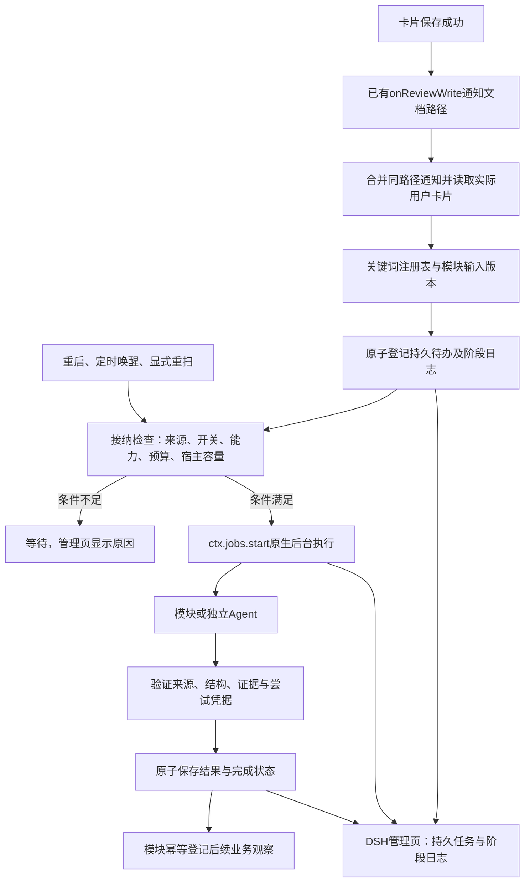

# 框架、生命周期与触发机制

> 设计调整（2026-10-10）：先读 [简单关键词入口与开放Agent工作流](00-simple-agent-workflow-principles.md)。本文保留旧技术细节；强制六方法、双执行分支和通用业务观察不再作为首版接入要求。

状态：详细设计草案。框架先交付，业务以`@预期`作为第一个模块接入。

## 1. 框架负责什么

框架负责标记解析、受控注册表、来源快照、持久任务接纳、版本去重、原生Jobs接线、结果校验入口、取消与恢复、阶段日志。模块负责理解业务、定义结果结构、提出后续检查请求及管理自己的业务条目。

框架不理解“预期兑现”、指数点位或模式规则；`scheduler.ts`不能出现expectationId的专用计算或预期判断代码。后续检查的业务对象用模块提供的opaqueBusinessKey（框架只当字符串处理），由模块读取和验证。



图中的持久待办是业务接纳记录；执行、运行中的取消和输出流交给宿主，不再复制一套通用JobRegistry。

## 2. 关键词识别与配置

复用前版明确语法：ASCII @、完整名字匹配、前边界限定、转义不触发；跳过围栏/行内代码、URL、邮箱、链接目标、图片引用和引用块。位置为实际Card.body中的UTF-16偏移，body.slice(start,end)必须等于raw。同一模块在一张卡片上多次出现只产生一次初始处理，可整理多条预期。

本轮生产注册表只包含预期，不提前添加无法使用的业务占位。未知关键词保留原文、提示未注册，不阻止保存。

`config/card-processors.json`由后端维护，第一版示例：

```json
{
  "schemaVersion": 1,
  "processors": [
    {
      "id": "expectation",
      "label": "预期整理与回查",
      "mentions": ["预期"],
      "moduleId": "expectation",
      "enabled": true,
      "initialStage": "extract",
      "stages": {
        "extract": {
          "executor": "agent",
          "skillId": "review-expectation-extract",
          "outputSchema": "expectation-extract@1",
          "context": ["card", "role", "history"]
        },
        "check": {
          "executor": "agent",
          "skillId": "review-expectation-check",
          "outputSchema": "expectation-check@1",
          "context": ["tracking", "marketEvidence"]
        }
      },
      "defaults": {"verifyAfterTradingDays": 1},
      "editableOptions": []
    }
  ]
}
```

moduleId必须对应插件已登记的处理器；stage/skill/schema组合必须被该模块接受。JSON不加载任意JS、不接受任意写路径。新增仅整理文字的自定义Skill可后续走一个通用结构化文字模块；新业务schema和数据源仍需要代码模块，不宣称仅改JSON就能实现任何功能。

注册表上限256KiB、32个模块、每模块8个别名；重复别名/未知模块/不匹配schema拒绝整份新表并保留旧表。有效definitionRevision对运行定义、有效参数、模块版本、Skill候选及实际正文哈希计算指纹；仅改中文说明不重跑。Skill实际作用域核验见第02份。

全局配置`review.processing.enabled`默认false；预期enabled=true只代表模块默认值，不越过全局开关。provider/model/cwd必须显式且可核验；Agent并发默认1、实际尝试最多2、单次120秒、每日启动尝试最多30、输出4096 tokens、正文上下文最多24000字符。设置页仅开关模块和预定义业务参数，版本冲突返回409。首版周期固定下一交易日。

## 3. 框架与模块的接口

拟在`src/review/processors/types.ts`声明：

```ts
interface ProcessorModule {
  readonly id: string;
  projectInput(card: SourceCardSnapshot, options: Readonly<Record<string, unknown>>): ModuleInput;
  prepare(request: PrepareRequest): Promise<PreparedExecution>;
  commitGuard(prepared: PreparedExecution): ModuleCommitGuard;
  validateResult(payload: unknown, context: ValidationContext): ValidatedModuleResult;
  afterCommit(result: CommittedModuleResult): Promise<FollowupRegistrationResult>;
  reconcileSource(change: SourceReconciliation): Promise<void>;
}
interface ModuleCommitGuard {
  recordKeys: readonly string[];
  verify(): Promise<void>;
}
interface FollowupRequest {
  processorId: string;
  stage: string;
  cardId: string;
  opaqueBusinessKey: string;
  sourceInputRevision: string;
  moduleInput: ModuleInput;
  evidenceRevision: string;
  earliestRunAt: string;
  triggerReason: string;
}
```

| 类型/方法 | 必须定义的业务含义 |
| --- | --- |
| SourceCardSnapshot | 实际相对文档路径、anchor、market/code、原交易日、原始body、sourceRevision、来源核验状态 |
| ModuleInput | 本模块实际输入及inputRevision、所命中的原文位置；不能返回任意保存路径 |
| PrepareRequest | taskId、stage、冻结输入、参数、模块业务键、signal及受控证据读取面 |
| PreparedExecution | definitionRevision、inputRevision、contextRevision、受控执行配置、证据编号；或明确waitingReason |
| ModuleCommitGuard | 代码生成的recordKeys和verify方法；框架把这些业务锁与task锁合并排序后持有，再调用verify；方法只短读/核验，不取网络、不再次取得锁 |
| ValidationContext | 冻结证据、允许schema、当前尝试凭据、来源版本；不得由模型指定这些值 |
| ValidatedModuleResult | 已验证payload及证据引用；由框架补固定声明和生成时间 |
| CommittedModuleResult | 已持久成功的taskId、结果、版本；afterCommit不得假设跨文件事务 |
| FollowupRegistrationResult | complete、pending或obsolete（业务已经关闭/换窗口等，不再适用），模块业务键及后续请求，便于重启补齐 |
| SourceReconciliation | 来源当前、改变、明确删除或暂不可读；模块决定暂停/撤回自己的业务对象 |

commitGuard的recordKeys仅能引用该模块已登记业务记录，不是模型提供的路径；无业务对象的初始执行返回空键和空核验。verify失败明确拒绝当前结果，避免模块仅凭冻结快照更新已关闭观察。

FollowupRequest由模块代码提出，不接收模型自选processor/stage/path。earliestRunAt是模块根据已核日期证明确定的最早执行时间，不是框架猜交易日；真实数据尚未齐备的业务观察先留在模块记录，齐备后生成该请求。moduleInput包含已接受业务条件和证据，框架仍以该模块project/prepare规则验证。请求由统一registerRequest登记、去重、计预算和日志，不开专属运行器。

prepare只能通过给定读取面访问数据/历史；afterCommit必须幂等。执行方式由stage.executor选择：data为受控函数，agent为宿主适配器。测试处理器通过同一接口接入，生产调度不对它特判。

## 4. 三种生命周期与四种身份

| 对象 | 生命周期 | 结束意味着什么 |
| --- | --- | --- |
| 用户卡片 | 保存、编辑、删除 | 原始记录的来源变化 |
| 业务处理任务 | 登记、等待、准备、执行、结果保存、清理 | 一次输入版本的处理完成或停止 |
| 模块业务观察 | 登记、暂停、观察、比对、人工确认、撤回 | 用户的观察事项闭环；不同于任务完成 |

| 字段 | 身份规则 |
| --- | --- |
| cardId | SHA-256([规范相对文档路径,anchor])，包含真实文档归属；不能用裸代码/anchor |
| taskId | SHA-256([requestKey,inputRevision,definitionRevision,requestSequence,evidenceRevision])；业务持久身份 |
| nativeJobId | 宿主start返回；每次接纳尝试另有值，不能做跨重启主键 |
| attemptId | 本地随机尝试编号，用于日志关联；不是调用权限，同任务重试更新 |
| attemptToken | 绑定该尝试的私有提交凭据；只存内部记录及工具闭包，不返回HTTP/日志；新尝试使旧凭据失效 |
| executionSessionId | 本次Agent会话；数据处理为null，重试新建独立会话 |
| opaqueBusinessKey | 模块的观察编号/窗口编号；框架不解释，例如预期模块的expectationId与windowId |

初始requestKey=cardId+processorId+initialStage。后续requestKey=processorId+opaqueBusinessKey+stage，业务键包含观察窗口。requestSequence在同组锁内取历史最大值+1；原生重试不增加序号。重复同序号或目录读取不完整报冲突，不依据mtime挑赢家。

sourceRevision是整张真实用户卡片版本，用于追溯；inputRevision是模块真正消费的输入版本，用于判断是否重跑。历史/角色/市场材料单独冻结成contextRevision。第一版预期消费整卡文字，不读图片字节；图像能力未开启时不因同名图片字节变化重跑。修改正文中的图片引用仍是文字变化，后续可由模块明确投影排除，框架不猜。

## 5. 生命周期状态

任务executionState：queued（待接纳）、waiting（条件不足）、preparing（已开始准备）、running（实际处理）、retryWaiting（可重试暂时失败）、succeeded、failed、canceled。

waitingReason：moduleDisabled、sourceNeedsReview、capability、budget、hostCapacity、targetDate、marketData、storage。reason只在对应状态有值；页面同时显示中文具体原因。来源applicability独立记录current、sourceChanged、sourceRemoved、sourceUnverified、configurationChanged。

| 变化 | 状态转换规则 |
| --- | --- |
| 持久登记成功 | queued；日志TASK_REGISTERED |
| 能力/日期/额度不足 | waiting；原因变化才追加日志，不每次轮询重复写 |
| 领取本地执行名额并通过初步核验 | preparing；接下来尝试创建原生job，不等于模型已启动；宿主拒绝可退回waiting |
| 实际发followup/数据请求前再次核验通过 | running；原子写attemptId、私有attemptToken和启动计数 |
| 结果合法且版本有效 | succeeded；afterCommit未完成则resultDelivery=pending，恢复补齐 |
| 可恢复网络失败 | retryWaiting；最多2次实际尝试，5秒初始退避 |
| schema错误、未知证据、未提交结果 | failed；等待显式重新处理，不循环自动试模型 |
| 关闭开关 | 未执行任务waiting/moduleDisabled；运行任务协作取消，待重新开启后显式/恢复接纳 |
| 删卡/删标记 | 对应任务canceled/sourceRemoved；模块业务明确撤回 |

任务成功后仍需等待原生job资源清理完成才释放并发槽；不能因JSON已成功立即启动下一实例。模块业务的最终确认只在其确认入口修改，机器不自动设置兑现/证伪。

RESULT_COMMITTED是不可逆的业务成功点。此后取消/关闭只能停止未完成投递或清理，保留succeeded与pending投递，不改canceled、不重跑已成功模型；重开后核验并只补业务登记。未提交的运行任务才转canceled。

## 6. 触发矩阵

| 入口 | 做什么 | 付费/网络执行条件 |
| --- | --- | --- |
| 输入/粘贴/未保存 | 浏览器本地识别提示 | 永不启动 |
| onReviewWrite(path) | 合并路径，重新parseDoc，比较用户卡片模块输入 | 保存成功且有效关键词、开关和能力通过后 |
| appendAinote通知 | 重读后用户body未变，任务复用 | 不因附注触发 |
| 完全相同输入重复保存 | 复用当前任务；不产生新初始任务 | 不重复调用 |
| 编辑正文 | 旧输入失效；模块暂停相关业务，登记新版整理 | 仅新版一次 |
| 删除单图 | 按该模块实际输入决定 | 文字预期不读图字节；引用变化按正文处理 |
| 定时唤醒 | 模块检查已到期观察，提出后续请求 | 目标日和证据完整才运行 |
| 插件启动/能力恢复 | 恢复既有非终态任务及pending结果投递 | 核验当前输入、开关、剩余尝试和定义版本 |
| GET页面/日志/状态 | 只读投影，发现遗漏返回reconciliationNeeded | 零排队、零网络、零模型 |
| 显式重扫/重新处理 | 有范围地登记/重跑；管理页记录用户触发原因 | 保持同一预算与去重规则 |

“登记成功后立即唤醒”不承诺模型立即运行。时间、能力、预算、容量都可能使它等待，日志必须说明。

## 7. 当前写事件的最小接线

复用onReviewWrite(listener)并由ctx.effect注销。listener同步只把安全文档路径放进内存dirty集合、唤醒后台合并器，不读取图片/历史、不调用模型、不在卡片保存路径上增加同步任务JSON写入。

后台按路径single-flight读取parseDoc实际结果，只消费cards；按该文档已登记cardId比对新增、变化、消失。每次读取携带内存generation；读期间再次写入时，旧读取不发布当前决策，循环读取最新版本。历史索引可用historySnapshot找文档，不能把被折叠的scanDailyCardTargets当唯一精确来源。

异步登记失败不能把Markdown成功改成保存失败。管理页/框架健康态记录registrationError，之后重扫修复。需要持久日志也失败时输出宿主诊断并显示storage不可用，不能伪称“已安排”。本轮明确是可恢复、最佳努力通知，不承诺严格一次触发或跨文件事务。

自动恢复默认最近7个自然日；同时遍历所有已有非终态任务、未结束业务对象、succeeded且resultDelivery=pending任务，不受7日限制。启用页明确展示“启动时会补处理最近7日中带已启用关键词的卡片”，全局默认关闭；启用后补处理属于明确开关行为并计预算。更早未登记的卡片由显式日期范围重扫处理，不做全vault无界扫描。

目录读取失败/不完整时不宣判删除。外部改名视旧来源和新来源，不追随同码文件；外部OneDrive变化依靠来源复核、启动/显式重扫和未结束条目的有界检查修复，fs.watch不作为权威。

## 8. 持久记录、版本保护与停止

路径均在既有白名单：`DB/review/processing/settings.json`；`DB/review/<YYYYMM>/processing/<cardId>/tasks/<taskId>.json`；模块业务在同级tracking下。新增processorRecords/processorSettings区域到mapping，不新建DB/expectations，不改DB/stock。

task JSON包含schemaVersion、recordVersion、身份/输入快照、定义和参数快照、requestKey/序号、执行/适用状态、等待原因、attempts、result、resultDelivery、timeline及日志截断信息。一份文件原子保存状态、结构化结果和阶段日志，不另设需要同步的result成功文件。跟踪是独立业务记录，afterCommit失败由结果恢复，不能称两文件事务。

核心字段供records.ts与HTTP投影对照：

| 字段 | 必需内容 |
| --- | --- |
| schemaVersion / recordVersion | 格式第一版1；每次原子更新递增的冲突版本 |
| taskId / cardId / processorId / stage | 业务任务、来源卡片、受控模块及阶段 |
| requestKey / requestSequence / opaqueBusinessKey | 当前组与单调序号；后续业务键，初始null |
| sourceSnapshot / moduleInput | 实际正文/市场/原交易日与模块投影，不能由模型提供 |
| sourceRevision / inputRevision / definitionRevision / contextRevision | 整卡、模块输入、实际运行定义、冻结材料的版本 |
| optionsSnapshot / executionProfile | 参数与Skill/schema/执行器/资源版本 |
| executionState / waitingReason / applicability | 第5节运行状态、等待原因、来源适用性 |
| preparationToken / activeAttemptToken | 内部准备/提交凭据，所有对外投影删除 |
| attempts | attemptId、startedAt、provider/model/sessionId、nativeJobId、runtimeInstanceId、finishedAt及outcome；准备失败仅入timeline，不增加尝试 |
| currentNativeJobId / runtimeInstanceId | 当前挂载实例的关联；重启/重挂载后旧关联仅为历史，不直接观察或取消 |
| nextAdmissionAt | 最早重新检查条件/退避时刻，不是交易日证明 |
| createdAt / updatedAt | 东八区带偏移时间，用于分页展示，不代替输入版本 |
| result | outputSchema、processorId、stage、输入/定义/上下文版本、generatedAt、evidence、已验证payload及框架固定declaration |
| resultDelivery | none（无结果）、pending（模块后处理待恢复）、complete（业务登记完成）、obsolete（条件已改变，明确停止投递并留原因） |
| error / warnings | 可判断错误码、中文说明和缺失，不解析中文驱动状态机 |
| timeline / omittedEventCount / firstRetainedSequence | 阶段事件及明确日志截断信息 |

runtimeInstanceId在每次框架挂载生成随机值，只有当前实例内存自有ID集合中的关联能observe/kill；历史同名nativeJobId不能指向当前宿主任务。

采用本模块私有Promise锁、同目录临时文件+rename。锁顺序固定卡片锁→配置锁→请求组锁→任务/业务记录锁；同层多键排序。来源短提交需要store新增withVerifiedCardSnapshot，直接核实际路径、anchor、body，不从缓存获取“仍当前”的证明。网络、原生start、Agent创建/运行及dispose都在锁外。

提交必须同时核inputRevision、当前请求序号、definitionRevision、attemptId及私有attemptToken、来源存在和模块开启；后续任务再执行模块业务commitGuard。所有task及业务recordKeys先合并按键排序取得，verify不在内部再次加锁。正文已经改变而事件尚未处理时也拒绝旧结果。仅整体sourceRevision变化、模块投影未变可刷新来源关联，但须在同一短核验中确认，不靠旧缓存放行。原子文件无法阻止外部OneDrive写者：提交前后复核，发现变化标过期；单profile内锁不是跨进程事务。

卸载顺序：停止接纳/唤醒→持久暂停运行记录→只kill自己保存的nativeJobId→等待done和执行Agent清理→注销controller/写监听器/定时器。不能停止主聊天。重启不恢复旧Agent会话，先核是否已有持久成功结果，避免模型已结束/进程未清理造成重复执行。

## 9. 本步骤可验收出口

无预期业务代码时，测试模块已能经同一接口完成：真实卡片输入→任务落盘→ctx.jobs执行→结果校验→管理页日志→取消/重启恢复。去掉测试模块注册后框架仍正常启动，生产没有额外关键词；这才允许进入预期模块实现。

## 10. 本步骤开发计划

详见 [01 框架与触发机制开发计划](../../superpowers/plans/2026-10-10-keyword-framework-01.md)：按任务 0–12 展开文件修改、输入输出、测试场景、验证命令及完成条件。计划覆盖本文件验收所需的第 02 份最小执行/日志接线；第 03 份预期业务另行实施。planning-with-files 的任务状态和检查记录在计划末尾提供入口，计划编制完成不表示框架已实现。
