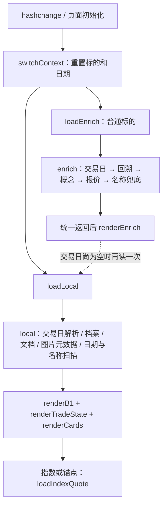

# 复盘卡片切换性能分析与 500ms 方案

分析与实施日期：2026-10-09（Asia/Shanghai）。P0 已实现并更新实际 DSH web profile；下面先列交付与验收，再保留改造前分析。

## P0 实施结果

- 档案由逐代码全目录扫描改为每个数据根共享完整快照（120 秒）；历史日期与名称共用市场、代码索引（30 秒）。预热异步进行，过期先读旧值并单飞刷新，失败保留旧值、告警且至少 5 秒后重试。
- `peekTradeDate()` 同步仅读内存；local 不调用 T0，也不把系统日期当成权威日期。显式日期不等待默认归属；后台按源 `fetchedAt + 60s` 刷新并在跨日重新获取。同 requestedDate 的显式/后台请求合并。
- local 最多等待当前卡片读取 350ms。**卡片完成就返回**，档案与历史不阻塞卡片；未完成段以 `loadState.profile/tradeDate/history/cards` 标明 loading/ready/error。同键共享后台任务，完成结果保留 5 秒。存储成功通知统一失效，失效前任务不得回填旧卡。
- 页面切换同步展示新代码并清除旧展示；local、enrich、指数请求用同一上下文代际和 AbortController。补读按 250/500/1000/2000ms，随后每 2000ms，最多 30 秒，不重叠；只更新变化区域，指数每个上下文只启动一次。
- 保留旧 Markdown、纯文字、图片安全校验和市场卡片定位；草稿按市场代码确认归属。额外修复原文不变保存后编辑器不退出、浏览器缓存恢复后读取停用。
- 不增加依赖、前端卡片缓存或新出站通道；未拆分 enrich，也未改图像读取策略。

后台分钟刷新会与用户查询竞争 S7 日额度。因此自主后台刷新分配日额度 20%（至少 1），并保留其余给前台；达到额度后保留真实旧快照，源时间不冒充已更新，并在 notes/health 明示跳过。显式调用仍遵守原 guard 总额度。一次原解析探测链可能跨过后台分配上限，之后停止自主刷新；并发前台增量可能被保守计入后台预算。

## 修复后实机证据

最终安装包 `dsh-trader-kit-0.1.0-p0-20261009-r2.tgz` 已更新 `C:\Users\luoyu\.dsh\profiles\web` 的 file 依赖，精确重启 DSH web 进程，最终进程为 66476。8 个关键 lib 文件 SHA256 与工作区一致；真实页面包含同步清理、补读、市场草稿和 pageshow 标记。旧包保留可回滚。没有修改 vault 卡片或既有档案。

测量客户端为 Node 的回环 HTTP，计时到 JSON 解析完成。新 DSH 开始服务即访问 local，日期为 2026-10-08；随后 6 个市场代码组合顺序切换 4 轮，另读一次自动日期。磁盘可能已有 OS 缓存，首次启动指进程内快照冷态，不声称 OneDrive 冷盘。以下是最终版本实测，**不是页面绘制时间**：

| 场景 | 改造前 local | 最终 local | 卡片 / 图片与状态 |
| --- | ---: | ---: | --- |
| 重启首次 sh000001 | 12970ms（原本轮首次） | 87.14ms | 3 / 0；档案、历史 loading，卡片 ready |
| 首轮 sh880863 | 6869ms | 5.98ms | 2 / 0；档案、历史 loading，卡片 ready |
| 首轮 sz000011 含图 | 8266ms | 14.23ms | 1 / 1；档案、历史 loading，卡片 ready |
| 首轮 sh510300 | 37ms | 5.22ms | 1 / 0，全部 ready |
| 同码换 sz000001 | — | 3.40ms | 0 / 0，未混入沪市三张卡 |
| 之后连续切换 18 次 | — | 1.89–4.36ms | 卡片正确，档案按 loading 继续补位 |
| 600519 自动日期 | 42ms | 7.68ms | 权威归属 2026-10-09，无卡 ready |
| 120 秒过期后切换 6 次 | — | 2.25–15.68ms | 先用旧快照并后台刷新，卡片正确 |

最终共 32 次，最大值为 **87.14ms**，未出现超过 500ms。后台完成后，sh000001 的名称“上证指数”和角色“情绪主锚”、sh880863 的名称“昨日涨停”和角色“赚钱效应”均已 ready；sz000011 原图片 GET 为 200/image/png、182240 字节。含图样本这里只含元数据响应和原图读取，未测解码/绘制。

第一版实机曾有 589.67ms 最大值，不能算通过；进一步取消卡片对档案/历史的等待后重新构建、安装、重启，以上仅列最终版本。原始时间记录在工作区忽略目录 `.accept-dataRoot/p0-first-pass-timings.json` 与 `.accept-dataRoot/p0-live-timings.json`，不含卡片正文。

通达信进程与 CEF 在运行，但窗口清单不暴露通达信窗口，CEF 未提供 remote-debugging 端口；Chrome 连接报 `nodeRepl.fetch request failed`，内置浏览器报 webview attach 超时。因实际 UI 通道不可用，**页面 DOM、绘制、宿主切换事件耗时未实测，不能宣称通达信端到端 500ms 已验收**。接口样本也不构成所有设备/负载下的硬上限保证。

## 完成验证与修改范围

`pnpm typecheck`、`pnpm build`、`pnpm test -- --maxWorkers=2` 通过：86 文件 / 845 项（原基线 80 / 811）。新增回归先红后绿，包含可控慢读取、后台补位、旧任务写后失效、缓存零网络、市场/日期竞态、指数只启动一次、同码草稿保护及编辑恢复。测试使用真实临时目录和回环 HTTP，不新增 mock/sleep；生命周期通过显式调度 seam 推进。旧图片测试按 loading 合法状态补读，最终仍断言完整图片字节与元数据。

仓库没有独立 lint 脚本；已运行 TS 静态检查、完整结构/安全扫描用例及 `git diff --check`。`node scripts/scan-compliance.mjs --self-test` 通过；实际 vault 扫描 22 份文档、负向词/缺声明为 0，但其中无 AI 附注/盘面产物，不冒充真实 AI 输出验收。构建仍有既有 external 弃用提示。

新增页面 HTTP 测试在两个结构扫描中具名登记，运行时必须满足 http、127.0.0.1 和本次临时服务端口；没有用字符串拼接绕过出站扫描。

修改文件分组：

- 后端：`src/routes/review.ts`、`src/review/{profile,context,store}.ts`，新增 `src/review/{snapshot,history,write-events}.ts`。
- 日期服务：`src/service/index.ts`，新增 `src/data/trade-date-cache.ts`。
- 前端：`src/client/review/index.html.ts`。
- 测试：新增 snapshot/history-cache/write-events/local-budget/context-page/trade-date-cache 六个测试文件；适配 routes-review 的 helpers/handler/images/structure、probe-registration 和 test/structure。
- 文档：本文件。已有 README、skill 和 card-processors 内容未改动。

剩余验收：取得可用通达信 UI 通道后测重启首次显示、连续切换、缓存过期与图片解码的最大绘制时间；外网 enrich 聚合及图片读取优化继续留待后续。

## 改造前分析与原始方案

以下保留实施前证据；代码行号指改造前版本，不能作为当前代码导航。前端缓存等原建议未全部纳入此次批准范围，以以上实施说明为准。

## 结论

优先处理 `/local` 的逐代码全量档案扫描。当前 `000xxx`、`88xxxx`、`999999` 会在代码缓存未命中或超过 120 秒时，同步读取整个 `DB/stock` 后筛选当前代码。实际目录有 810 份 Markdown。实测三个相关标的本地接口首次本轮请求耗时 6.9–13 秒，重复请求下降到 28–143ms。

第二个瓶颈是 `/enrich` 的串行聚合：交易日 → 最多六天涨停回溯 → 概念 → 报价 → 名称兜底，最后一次性返回。前端已并行调用 `/local` 和 `/enrich`，因此只把前端请求改成 `Promise.all` 无法解决。

500ms 必须区分两种验收：

- **接口及时返回、正确标的首屏可用**：通过本地索引、缓存、独立补位与截止预算实现。未取得的数据明确显示加载中或不可用。
- **所有字段都是新鲜、完整的数据**：需要相关标的与日期已经预取成功；未知标的首次外网取数受数据源与护栏影响，无法无条件保证 500ms。返回占位或旧缓存不能算作完整新鲜数据达标。

## 本轮运行证据

访问运行中的 `http://127.0.0.1:3080/dsh-trader-kit/review`。已比较安装包与工作区的六个关键编译文件：路由、页面、service、交易日、报价、名称解析，SHA256 均一致。

计时使用顺序请求与 Stopwatch；未清除宿主缓存、未重启，下面“首次”指本轮对该组合的首次采样，不代表完全冷启动。PowerShell 首次 HTTP 调用还包含客户端初始化开销。样本数量不足以计算 p95/p99。

| 请求 | 卡片 / 图片 | 首次本轮请求 | 紧接着重复请求 |
| --- | --- | ---: | ---: |
| local：sh000001，2026-10-08 | 3 / 0 | 12970ms | 51ms |
| local：sh880863，2026-10-08 | 2 / 0 | 6869ms | 28ms |
| local：sz000011，2026-10-08 | 1 / 1 | 8266ms | 143ms |
| local：sh510300，2026-10-08 | 1 / 0 | 37ms | 22ms |
| local：600519，显式 2026-10-09 | 0 / 0 | 340ms | 8ms |
| local：600519，自动交易日 | 0 / 0 | 42ms | 29ms |

600519 的 enrich（显式 2026-10-09）为 **1170ms**；报价与概念均成功，涨停回溯检查了六个自然日。

另外直接从已安装模块隔离计时，在本轮文件读取已经发生后：

- `readStockProfiles({codes:['000001']})`：891ms；`880863`：759ms。
- 对应本地历史名称扫描：3ms / 2ms，均为 code-only。
- `000011` 的 locate + parse：10ms；一张图的元数据：2ms。

这些分段测量确认全量档案扫描即使在文件已访问后仍超出 500ms。首次 API 的全部 6.9–13 秒尚未通过服务端埋点逐项归因；OneDrive 首次文件访问、I/O 状态和同时运行的任务可能放大时延。不能把全部时延都直接归到图片或外网。

以上是 HTTP 响应和隔离模块耗时，尚未测量通达信事件送达、浏览器 DOM、绘制及图片解码的端到端耗时。

## 当前获取与渲染链路

### 前端

- `src/client/review/index.html.ts:1146`：`switchContext` 重置状态，随后调用 `loadLocal(false)` 和 `loadEnrich()`，两路请求并行。
- `:943`：本地请求返回后，才在 `:959` 开始刷新名称、日期和卡片。切换时没有立即刷新代码并清除旧卡片，因此等待期间可能仍看见旧标的。
- `:1110`：enrich 有 AbortController 和代际检查，旧响应不会写回新标的；local 没有相同保护。A→B 快速切换后 A 的迟到响应可覆盖 B 的卡片、名称和日期。
- `:1074`：enrich 补出交易日时可能再次 `loadLocal(true)`，产生重复回读与全量 DOM 重绘。
- `:966`：指数/锚点行情在 local 完成后才启动，因此会被档案扫描拖住。前端会跳过相应 enrich；直接测量这些代码的 enrich 不能当作实际指数页面链路。
- `:911`：卡片容器每次清空再重建；`:613` 起为图片建立原图请求，未做懒加载。图片解码开销尚未实测。
- 页面只监听 hashchange；query/path 改变若来自宿主导航，可能重载页面。当前 review 页没有挂载 TvChart，也没有定时轮询，未发现图表重建的证据。

### 后端

| 问题 | 代码入口 | 影响 |
| --- | --- | --- |
| 每个代码各自触发全目录档案读取 | `src/routes/review.ts:498`、`:507`、`:586`；`src/review/profile.ts:126`、`:157` | 扫 810 份文件后才过滤；跨代码不复用扫描结果，120 秒过期又同步扫描 |
| 注释声称档案预热和后台刷新，实现却同步 await | `src/routes/review.ts:487`、`:507`、`:1421` | 实际预热仅 T0，首次切换与过期切换仍阻塞 |
| local 缺省日期依赖 T0 数据能力 | `src/routes/review.ts:573`；`src/service/index.ts:97`；`src/data/trade-date.ts:91`、`:108` | 无最终结果内存缓存；缓存未命中可能出网，成功磁盘数据也会重复解析与会话探针 |
| enrich 串行等所有段 | `src/routes/review.ts:696`、`:710`、`:722`、`:733`、`:768`、`:791` | 慢回溯阻止报价、概念与名称显示 |
| 回溯六次，每次最多五秒 | `src/review/enrich.ts:37`、`:190`、`:250` | 回溯等待可约 30 秒，另加前后阶段；超时竞速没有取消底层 fetch |
| 单次 HTTP 默认十秒、额外重试两次 | `src/config.ts:35`；`src/data/http.ts:157`、`:192` | 按源码默认配置，一条源请求可约 31 秒；不包含排队/当日源回退 |
| 源护栏最小间隔默认一秒，等待并发位无截止 | `src/config.ts:20`；`src/data/guard.ts:189` | 连续切换会排队；旧任务没有完整取消传播，继续占位 |
| 报价每次出网，五秒超时 | `src/data/quote-name.ts:67`、`:85` | 历史数据已缓存也仍依赖报价网络 |
| 日期、名称各扫一次月份目录 | `src/routes/review.ts:365`、`:622`；`src/review/context.ts:71` | 重复目录 I/O；名称只识别 code_，遗漏市场前缀文件，额外触发网络名称兜底 |
| 图片元数据完整读图 | `src/routes/review.ts:614`；`src/review/images.ts:87`、`:99` | 每卡每图顺序读取，安全路径重复解析；图片 GET 再次读图 |

当前数据缓存主要是磁盘 JSON（`src/data/cache.ts:75`），并非所有数据都有进程内缓存、TTL 或同键请求合并。S7 已按源与 requestedDate 跨代码复用，保留这个契约；不能再给每个代码重取全市场列表。

## 改造顺序与最小范围

### P0：去掉首屏全量扫描

1. 把档案缓存从“每代码读整个目录”改为“整个目录一份快照索引”，code 查询只查内存。全局指同一 dataRoot 的共享快照，不能跨数据根混用。
2. 在注册/启动阶段异步构建索引；已存在的旧快照过期后立即使用并后台刷新，同一刷新任务只运行一次。首次无快照时先显式 pending，不在首屏同步扫描。
3. 如需首次完整角色/名称也在 500ms 内返回，必须在页面可用前完成预热，或使用已持久化且可验证的索引。仅异步 pending 不满足“完整数据”的定义。
4. 复用 `readStockProfiles` 已有的 `opts.profiles` seam，让页面查询复用扫描结果；保留名称匹配、mtime 多命中规则和非锚点条目的原语义，不仅缓存 anchors 子集。
5. local 单独读当前复盘文档，名称优先使用本次已解析 frontmatter；历史日期、名称采用共享目录索引或独立补位，避免首屏双重全月扫描。
6. local 的自动交易日改为缓存只读入口。沿用 T0 已解析的权威结果，缓存缺失就声明待确认并后台解析；不得拿系统日期伪造交易日。会话数据刷新、跨限流日时定向失效。

首先解决这一步，已有样本表明本地首屏有降到几十至一百多毫秒的基础，但这不是改造后的性能承诺。

### P0：切换正确性与及时反馈

1. 切换后立即展示目标代码，清空旧标的的卡片、行情、角色和错误状态；旧草稿继续沿已有归属确认保护。
2. local、enrich、指数行情统一捕获上下文代际。响应只有在 market、code、日期意图及代际一致时才能写入；自动日期解析用代际识别，不因响应补入日期误判自身过期。
3. local 也支持中断，合并相同上下文在途请求；交易日补位仅在实际改变卡片归属日期时回读。
4. 增加有界前端缓存用于回访；服务端缓存保证页面重载时仍能受益。写卡、修订、删除及图片删除成功后定向失效。

### P1：网络补充独立返回

1. 报价/概念/涨停回溯独立并行任务，完成一块渲染一块。使用普通 JSON 分段读接口即可，无需引入新依赖或流式协议。
2. 仅把内部改成 `Promise.all`、仍等最慢任务再统一返回，不足以达到 500ms；可保留旧 enrich 兼容既有消费方，页面走新分段读路径。
3. 为报价增加短 TTL 缓存；概念与回溯按事实日期/源语义缓存，盘后成功历史事实可长时间复用。报价 TTL 必须按新鲜度要求确定，缓存值显示 fetchedAt，不能冒充当前报价。
4. S7 保留 source+requestedDate 的持久缓存键，增加进程内镜像和同键任务合并；可复用 `src/skill/download.ts:236` 的在途 Map 模式。概念成功结果已含 code，不能在不同标的间混用。
5. 前台请求自入口设总截止预算，覆盖排队、退避、传输和装配；重试放到后台。保持现有护栏，不靠降低频控来达到目标。
6. 取消信号传递至排队和 HTTP fetch。共享取数任务需区分消费者取消与任务取消：离开页面只撤销本消费者，仍有其它消费者时不能中断共享任务。
7. 日期缓存、当前数据和失败重试需有明确时效；无数据、未完成、源失败与陈旧缓存必须区分，不用 0 或空列表伪造事实。

### P2：图片与 DOM

- 元数据读取保留路径、符号链接、类型、大小与文件头验证，仅读必要文件头；整图在图片 GET 中读取。避免优化时削弱已有安全检查。
- 文档内相同附件只检查一次；元数据缓存按文件变更状态失效。
- 图片使用懒加载与异步解码；大量卡片分批渲染。是否需要 DocumentFragment/更多 DOM 优化，以浏览器测量为准。

## 500ms 时间预算与验收

建议先把 **HTTP 响应上限** 与 **页面首屏完成** 单独统计。下面是设计预算，不是已实测结果：

| 环节 | 预算 |
| --- | ---: |
| 接收切换事件、立即反馈新代码 | 20ms |
| local：内存索引 + 当前文档 + 必要元数据 | 150ms |
| 回环请求与 JSON 处理 | 50ms |
| DOM 更新与绘制余量 | 80ms |
| 文件系统和调度余量 | 200ms |
| 总计 | 500ms |

补充接口入口预算建议控制在 350ms 内，只返回已取得的快照/状态，给页面留出处理和绘制时间；过期快照后台更新。同步磁盘 I/O 若超预算，也必须降级到明确 pending，不能返回“已完整读取”的假空态。

通过 performance.mark/measure 记录切换、请求、响应、DOM 更新；再用浏览器性能轨迹核对绘制时刻。`requestAnimationFrame` 回调发生在绘制前，不能把回调开始时间直接等同于已显示。基础测量 API 见 [MDN Performance.measure](https://developer.mozilla.org/en-US/docs/Web/API/Performance/measure)。

验收分开报告：

1. 宿主联动到页面事件、页面事件到首屏、local HTTP、各补充字段完成时刻。
2. 正确目标首屏 p95 ≤500ms；若要求每次都 ≤500ms，还须测最大值并定义超预算的 pending 行为，p95 不代替硬上限。
3. 重启首次访问、每个未访问代码、索引过期、跨日、OneDrive 文件未就绪、无数据根、无交易日缓存。
4. 普通股票、同码指数/股票、88 板块、999999、有图卡片及大量历史月份。
5. A→B→C 快切和日期切换，任何迟到响应不得覆盖新上下文；同键并发不得重复扫描/出站。
6. 外网慢/失败与护栏排队下，local 仍及时返回；未获取的新鲜信息独立显示真实状态。
7. 旧 Markdown、纯文本卡片、旧接口与 market 归属保持兼容；用户判断字段与既有档案不被改写。

## 实施前回归保护与完成门禁

这份文档即改造前计划。实施前先锁定现有交易日、市场归属、档案多命中和图片安全行为；新增真实临时目录与受控本地 HTTP 服务测试，不引入 mock/sleep。性能断言不要只靠容易波动的耗时，更应检查：首屏零全量档案扫描、缓存未命中不偷偷出网、同键扫描一次、旧响应无法写回。

拟涉及文件：`src/routes/review.ts`、`src/review/profile.ts`、`src/review/context.ts`、`src/client/review/index.html.ts`；第二步再涉及 `src/service/index.ts`、`src/data/guard.ts`、`src/data/http.ts`、报价/缓存模块；图片优化单独处理 `src/review/images.ts`。分批验证与回滚。

每批实施运行 typecheck、build、test、合规扫描；仓库目前没有独立 lint 脚本。实施后的 profile 与实测结果见本文开头；通达信绘制验收仍未完成。

本轮基线验证：`pnpm typecheck`、`pnpm build`、`pnpm test` 均通过（80 个测试文件 / 811 项测试）；`node scripts/scan-compliance.mjs --self-test` 通过。文档围栏和尾随空白检查通过。构建存在既有 `external` 配置弃用提示，不影响成功结果。
